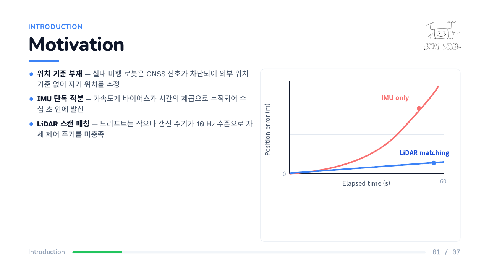
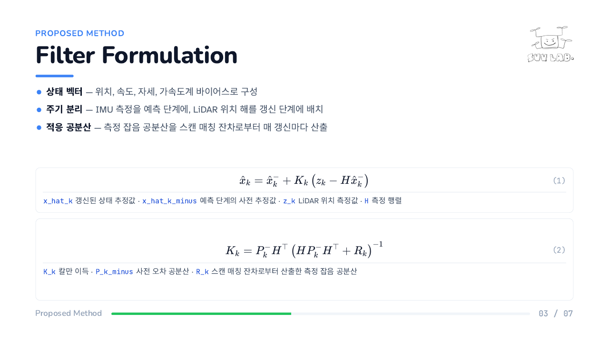
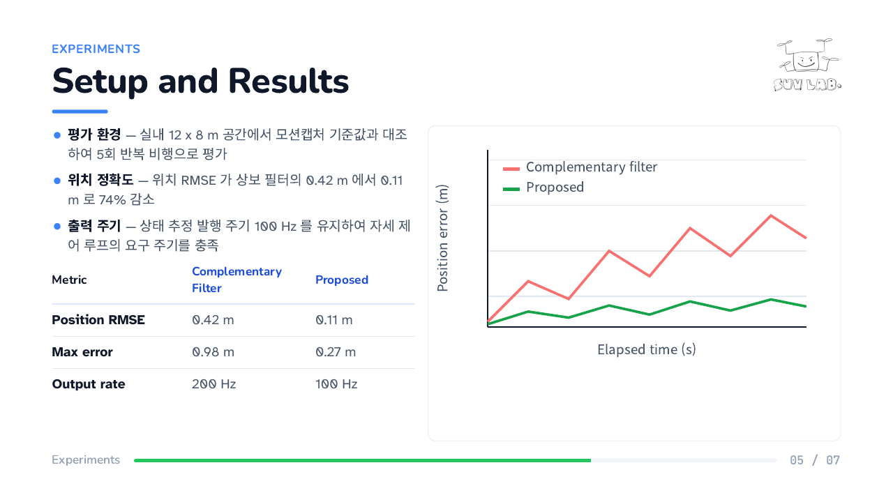
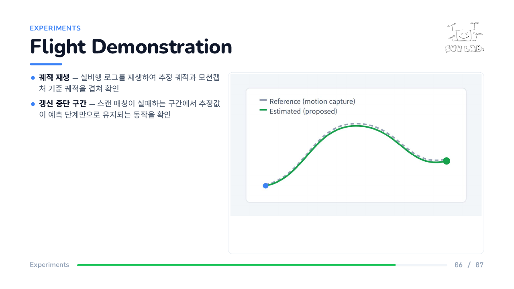

# SUVLab 랩세미나 발표자료 양식

발표 내용을 `contents.md` 에 문장 단위로 작성하면, 클로드가 `design/mydesign.md` 규격에
맞추어 슬라이드 원고 `slide.md` 와 검토 의견 `review.md` 를 작성하고 덱 HTML 과 PDF 를
생성한다.

- 아트보드 1920x1080 (16:9). 슬라이드 한 장이 PDF 한 쪽에 대응한다
- 난독증 친화 서체와 24px 하한으로 원거리 가독성을 확보한다
- 격자 배치로 그림, 수식, 표의 정렬을 일정하게 유지한다
- 브라우저에서 전체 화면 발표가 가능하며 동영상을 슬라이드에 포함할 수 있다
- 수식은 KaTeX 로 조판하고 번호는 오른쪽 끝에 정렬한다

---

## HOW TO USE

| 단계 | 수행 내용 | 주체 | 산출물 |
|---|---|---|---|
| 1 | `./create.sh` | 사용자 | `contents.md`, `materials/`, `output/imgs/` |
| 2 | `contents.md` 에 발표 내용을 작성 | 사용자 | `contents.md` |
| 3 | 클로드에 **"컨텐츠 제작"** 지시 | 클로드 | `slide.md`, `review.md`, 덱 HTML, PDF |
| 4 | 덱 HTML 을 브라우저에서 열고 `F` 입력 | 사용자 | 전체 화면 발표 |

사용자가 직접 수행하는 단계는 1, 2, 4 이다. 원고 작성, 덱 HTML 생성, `build.sh` 실행에
의한 PDF 생성은 3 단계에서 클로드가 일괄 수행한다.

### 1. 작업 폴더 생성

```bash
./create.sh
```

`contents.md`, `materials/`, `output/imgs/` 를 생성한다. `contents.md` 가 이미 존재하면
덮어쓰지 않는다.

### 2. contents.md 작성

사용자가 직접 작성하는 유일한 내용 파일이다. 발표에서 설명할 내용을 그대로 기술한다.
클로드에 대한 지시문을 기술하는 파일이 아니다.

- 올바른 예: `IMU 단독 적분은 바이어스가 누적되어 수십 초 안에 발산한다`
- 잘못된 예: `IMU 의 한계를 한 문장으로 적는다`

| 표기 | 의미 |
|---|---|
| `#` | 덱 제목. 영문으로 작성한다 |
| `## Cover` | 표지. 구분, 파트, 주제, 발표자를 기술한다 |
| `##` | 장. 슬라이드 키커가 된다. 영문으로 작성하면 CSS 가 대문자로 변환한다 |
| `###` | 슬라이드 하나. 제목도 영문으로 작성한다 |
| `- ` | 문단 하나를 압축한 한 문장 |
| `구분 슬라이드: 필요` | 해당 장 앞에 파트 구분 슬라이드를 삽입한다. 장 이름만 배치하며 머리말, 푸터, 번호를 두지 않는다 |

원본 자료는 `materials/` 에 배치한다. 덱에 포함되는 변환본은 클로드가 `output/imgs/` 에
생성한다.

| 종류 | 표기 |
|---|---|
| 그림 | `그림: materials/파일명.png - English alt label` |
| 동영상 | `동영상: materials/파일명.mp4 - poster: materials/파일명_poster.jpg` |
| 표 | `표:` 다음 줄부터 마크다운 표를 작성한다. 머리행은 영문으로 작성한다 |
| 수식 | `수식:` 다음 줄부터 `$$` 로 감싸 작성하고, 기호 설명을 불릿으로 잇는다 |

- 구어체를 사용하지 않는다. 형식을 갖춘 개조식으로 작성한다
- 제목은 영문으로 작성한다
- 수식 내부에는 ASCII 만 사용한다. 한글과 `·` `×` `→` `≤` 등의 비-ASCII 기호는 수식 밖에 기술한다

### 3. 컨텐츠 제작

클로드에 **"컨텐츠 제작"** 을 지시한다. 클로드는 다음 네 가지를 생성한다.

| 산출물 | 내용 |
|---|---|
| `slide.md` | 발표자료 원고. 수식, 표, 그림, 동영상을 포함한 마크다운 |
| `review.md` | 발표 내용의 부족한 부분, 논리적 결함, 보완 사항 |
| `output/<타이틀>_<학생이름>.html` | `design/` 규격의 덱 HTML |
| `output/<타이틀>_<학생이름>.pdf` | `build.sh` 실행으로 생성한 PDF |

`review.md` 를 먼저 확인한다. 근거가 없는 수치, 누락된 전제, 검증되지 않은 주장을
근거 위치와 함께 지적한다. 수정 사항은 `contents.md` 에 반영한 뒤 "컨텐츠 제작" 을
다시 지시한다.

배포물 이름은 `contents.md` 표지의 `- 주제:` 줄을 타이틀로, `- 발표:` 줄의 마지막
낱말을 학생 이름으로 사용하여 `<타이틀>_<학생이름>` 으로 결정한다. 타이틀에서 공백과
특수기호를 제거하고 낱말 경계는 각 낱말의 첫 글자를 대문자로 유지한다.

```python
import re
words = re.split(r'[^0-9A-Za-z가-힣]+', title)
slug = ''.join(w[:1].upper() + w[1:] for w in words if w)
```

### 4. 슬라이드 편집 - 선택

생성된 덱을 직접 수정할 경우 `editor/` 서브모듈의 로컬 에디터를 사용한다.

```bash
python3 editor/editor.py output
```

### 5. PDF 재생성 - 선택

3 단계에서 클로드가 이미 실행한다. 덱 HTML 또는 `design/` 을 직접 수정한 경우에만
사용자가 실행한다.

```bash
./build.sh                                             # output/ 의 덱 HTML 을 대상으로 한다
./build.sh EKFBasedStateEstimationForIndoorUAV_홍길동   # 덱이 여럿인 경우 이름을 지정한다
```

### 6. 발표

`output/<타이틀>_<학생이름>.html` 을 브라우저에서 열고 `F` 를 입력한다.

| 키 | 동작 |
|---|---|
| `F` | 전체 화면 시작. 현재 슬라이드부터 진행한다 |
| 스페이스 · `→` · `↓` · PageDown · Enter | 다음 장 |
| `←` · `↑` · PageUp · Backspace | 이전 장 |
| Home · End | 처음 · 마지막 |
| `B` | 화면 일시 소등 |
| Esc | 종료 |

### slide.md 표기

클로드가 작성하는 파일이며, 사용자가 읽고 수정할 수 있도록 마크다운으로 유지한다.

```markdown
## 01. Slide Title In English

키커: Section Name

- **말머리** — 설명

리드
: 슬라이드 한 줄 요약

경고 카드 · 카드 제목
: 반드시 기억해야 할 한 문장이 있을 때만 사용한다

| Header | Header |
|---|---|
| 항목 | 내용 |

$$
y = a x^2 + b x + c \tag{1}
$$

- `a, b, c` 계수
- `x` 입력
- `y` 출력


```

- 표의 머리행은 영문으로 작성한다
- 수식 번호는 `\tag{n}` 으로 부여하고 기호 설명을 바로 아래에 한 줄씩 기술한다
- 동영상에는 `poster` 를 반드시 지정한다. PDF 에는 해당 정지 화면이 수록된다

---

## EXAMPLE

견본 한 벌이 `instruction/example/` 에 있다. `contents.md`, 그것으로 생성한 `slide.md`
및 `review.md` 로 구성된다. 아래는 그 견본을 실제로 빌드하여 생성한 13쪽 덱이다.

입력한 `contents.md` 의 일부는 다음과 같다.

```markdown
# EKF-Based State Estimation for Indoor UAV

## Cover

- 구분: Lab Seminar
- 파트: Indoor Autonomous Flight
- 주제: EKF-Based State Estimation for Indoor UAV
- 발표: 충북대학교 지능로봇공학과 홍길동

## Introduction

구분 슬라이드: 필요

### Motivation

- 실내 비행 로봇은 GNSS 신호가 차단되어 외부 위치 기준 없이 자기 위치를 추정해야 한다
- IMU 단독 적분은 가속도계 바이어스가 시간의 제곱으로 누적되어 수십 초 안에 발산한다

그림: materials/sensor_limits.png - IMU drift versus LiDAR update rate
```

생성 결과는 다음과 같다.


| | |
|---|---|
|  |  |
| 글과 그림 | 수식. 번호는 오른쪽 끝에 정렬한다 |
|  |  |
| 표와 그래프 | 동영상. PDF 에는 poster 가 수록된다 |

슬라이드 종류와 배치 규칙의 전문은 [design/README.md](design/README.md) 와
[design/mydesign.md](design/mydesign.md) 에 있다.

---

## HOW TO INSTALL

### 저장소 복제

`editor/` 가 서브모듈이므로 함께 받는다.

```bash
git clone --recurse-submodules https://github.com/SUV-Lab/labseminar_temp.git
cd labseminar_temp
```

이미 복제한 경우에는 다음을 실행한다.

```bash
git submodule update --init
```

### 필요 도구

| 도구 | 용도 | 확인 |
|---|---|---|
| `google-chrome` | HTML 을 PDF 로 인쇄 | `google-chrome --version` |
| `pdfinfo` (poppler-utils) | 쪽수 확인 | `pdfinfo -v` |
| `ffmpeg` | 동영상 변환과 poster 추출. 동영상을 사용할 때만 필요 | `ffmpeg -version` |
| `python3` | 슬라이드 편집기 실행. 편집기를 사용할 때만 필요 | `python3 --version` |

```bash
sudo apt install poppler-utils ffmpeg
```
