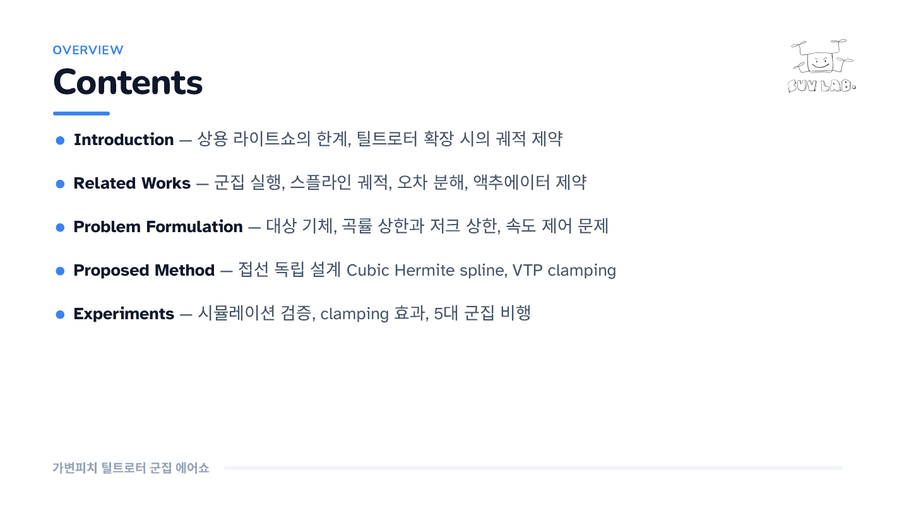
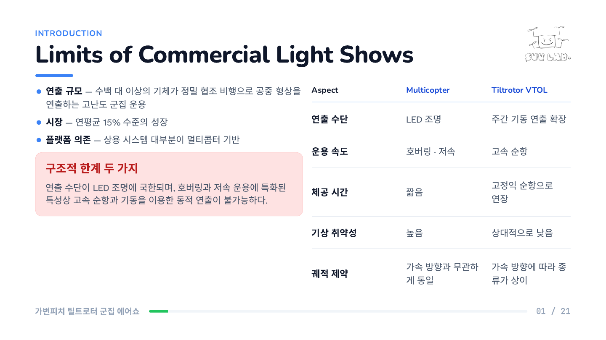
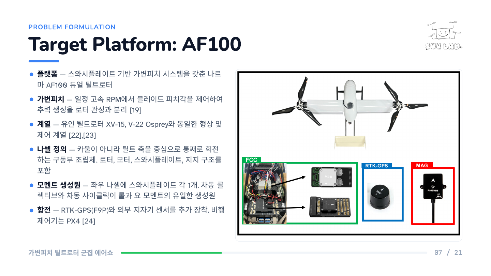
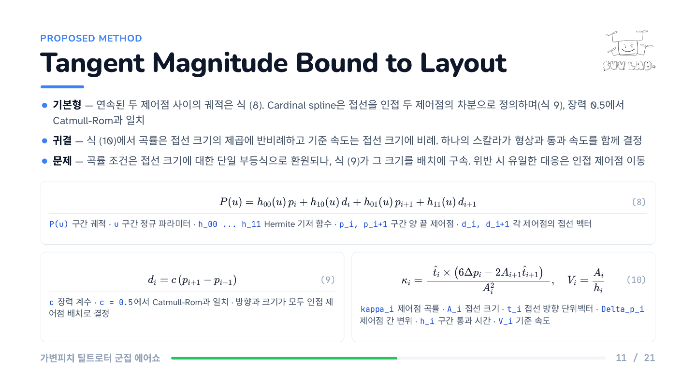
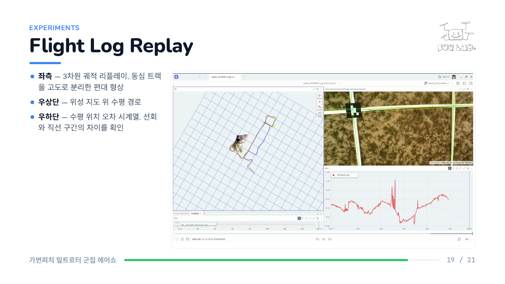
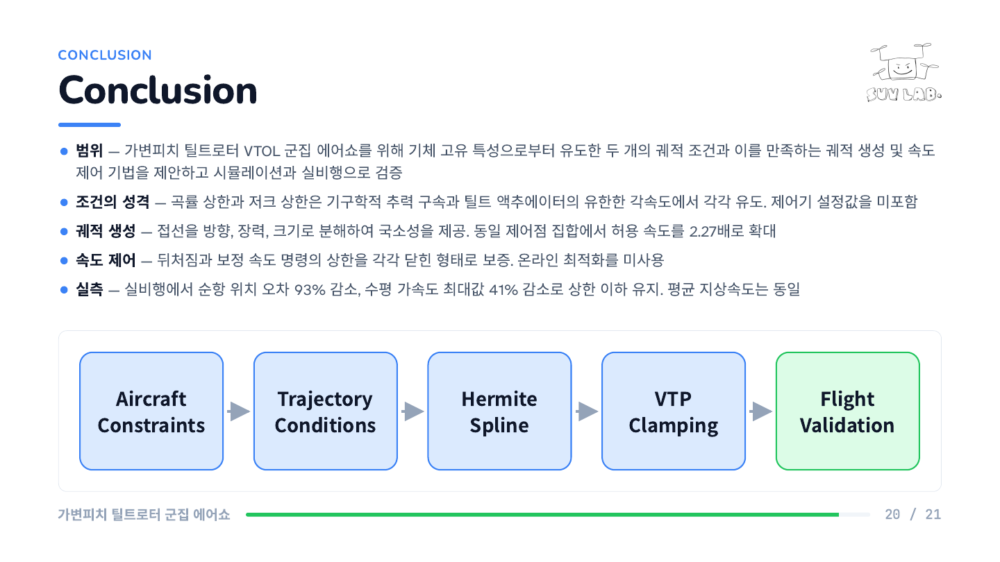

# SUVLab 랩세미나 발표자료 양식

내용을 `contents.md` 에 한 문장 단위로 적으면, 클로드가 `design/mydesign.md` 규격에 맞는
슬라이드 원고 `slide.md` 와 검토 의견 `review.md` 를 쓰고, 덱 HTML 과 PDF 를 만든다.

- 아트보드 1920x1080 (16:9). 슬라이드 하나가 PDF 한 쪽이 된다
- 난독증 친화 서체와 24px 하한으로 뒤에서도 읽히는 글자 크기를 강제한다
- 배치를 격자로 고정해 그림, 수식, 표의 열과 오가 저절로 맞는다
- 브라우저에서 그대로 전체 화면 발표가 되고, 동영상도 슬라이드에 넣을 수 있다
- 수식은 KaTeX 로 그리고, 번호는 오른쪽 끝에 붙는다

---

## 이렇게 나온다

`contents.md` 한 벌로 구운 실제 슬라이드다.


| | |
|---|---|
|  |  |
| 목차 | 본문 - 글과 표 |
|  |  |
| 수식. 번호는 오른쪽 끝 | 본문 - 글과 그림 |
|  |  |
| 동영상. 브라우저에서 그대로 재생된다 | 결론 |

슬라이드 종류와 배치 규칙은 [design/README.md](design/README.md) 에 더 있다.

---

## 빠른 시작

| # | 무엇을 한다 | 누가 | 나오는 것 |
|---|---|---|---|
| 1 | `./create.sh` | 사람 | `contents.md`, `materials/`, `output/imgs/` |
| 2 | `contents.md` 에 발표할 내용을 문장으로 적는다 | 사람 | `contents.md` |
| 3 | 클로드에 **"컨텐츠 제작"** 이라고 지시한다 | 클로드 | `slide.md`, `review.md`, `output/<타이틀>_<이름>.html`, 같은 이름의 `.pdf` |
| 4 | 그 HTML 을 브라우저로 열고 `F` | 사람 | 전체 화면 발표 |

사람이 직접 하는 것은 1, 2, 4 뿐이다. 발표자료를 쓰고 덱 HTML 을 굽고 `build.sh` 로
PDF 까지 만드는 것은 3 단계에서 클로드가 한꺼번에 한다.

`review.md` 는 클로드가 적은 검토 의견이다. 먼저 읽고 고칠 것을 `contents.md` 에
반영한 뒤 다시 "컨텐츠 제작" 을 지시한다. 각 단계 자세한 설명은 [사용 순서](#사용-순서) 를 본다.

---

## 준비물

| 도구 | 용도 | 확인 |
|---|---|---|
| `google-chrome` | HTML 을 PDF 로 인쇄 | `google-chrome --version` |
| `pdfinfo` (poppler-utils) | 쪽수 확인 | `pdfinfo -v` |
| `ffmpeg` | 동영상 변환과 poster 추출. 동영상을 넣을 때만 | `ffmpeg -version` |

```bash
sudo apt install poppler-utils ffmpeg
```

---

## 사용 순서

### 1. 작업 폴더 준비

```bash
./create.sh
```

`contents.md`, `materials/`, `output/imgs/` 를 만든다. `contents.md` 가 이미 있으면 덮어쓰지 않는다.

### 2. contents.md 작성

사람이 직접 쓰는 유일한 내용 파일이다. **발표에서 말할 내용을 그대로 쓴다.**
클로드에게 시키는 지시문을 쓰는 곳이 아니다.

- 쓸 것: `IMU 단독 적분은 바이어스가 누적되어 수십 초 안에 발산한다`
- 쓰지 말 것: `IMU 의 한계를 한 문장으로 적는다`

```markdown
# EKF-Based State Estimation for Indoor UAV

## Cover

- 구분: Lab Seminar
- 파트: Indoor Autonomous Flight
- 주제: EKF-Based State Estimation for Indoor UAV
- 발표: 충북대학교 지능로봇공학과 홍길동

## Introduction

구분 슬라이드: 필요

### Motivation

- 실내 비행 로봇은 GNSS 신호가 차단되어 외부 위치 기준 없이 자기 위치를 추정해야 한다
- IMU 단독 적분은 가속도계 바이어스가 시간의 제곱으로 누적되어 수십 초 안에 발산한다

그림: materials/sensor_limits.png - IMU drift versus LiDAR update rate
```

| 표기 | 뜻 |
|---|---|
| `#` | 덱 제목. 영어 |
| `## Cover` | 표지. 구분, 파트, 주제, 발표자 |
| `##` | 장. 슬라이드 키커가 된다. 영어로 적으면 CSS 가 대문자로 바꾼다 |
| `###` | 슬라이드 하나. 제목도 영어 |
| `- ` | 문단 하나를 압축한 한 문장 |
| `구분 슬라이드: 필요` | 그 장 앞에 파트 구분 슬라이드를 넣는다. **장 이름 하나만** 놓인 슬라이드이며 머리말, 푸터, 번호가 없다 |

### 자료 표기

원본 파일은 `materials/` 에 둔다. 덱에 들어가는 변환본은 클로드가 `output/imgs/` 에 만든다.

| 종류 | 표기 |
|---|---|
| 그림 | `그림: materials/파일명.png - English alt label` |
| 동영상 | `동영상: materials/파일명.mp4 - poster: materials/파일명_poster.jpg` |
| 표 | `표:` 다음 줄부터 마크다운 표를 그대로 적는다. 머리행은 영어 |
| 수식 | `수식:` 다음 줄부터 `$$` 로 감싸 적고, 기호 설명을 불릿으로 잇는다 |

표와 수식은 이렇게 적는다.

```markdown
표:

| Method | Update Rate | Limitation |
|---|---|---|
| IMU integration | 200 Hz | 수십 초 안에 발산 |
| LiDAR scan matching | 10 Hz | 제어 주기 미달 |

수식:

$$
\hat{x}_{k} = \hat{x}_{k}^{-} + K_{k}\left(z_{k} - H\hat{x}_{k}^{-}\right)
$$

- `x_hat_k` 갱신된 상태 추정값
- `K_k` 칼만 이득
```

수식 안에는 ASCII 만 넣는다. 자세한 금지 항목은 아래 [수식 규칙](#slidemd-표기) 을 본다.

- 구어체를 쓰지 않는다. 형식을 갖춘 개조식으로 적는다
- 타이틀은 가급적 영어로 적는다

### 3. 컨텐츠 제작 - 클로드가 쓴다

클로드에 **"컨텐츠 제작"** 이라고 지시한다. 클로드가 `build.sh` 실행까지 맡아 넷을 만든다.

| 산출물 | 내용 |
|---|---|
| `slide.md` | 발표자료 내용. 수식, 표, 그림, 동영상을 포함한 마크다운 원고 |
| `review.md` | 발표 내용에서 부족한 부분, 논리가 닫히지 않는 부분, 보완할 사항 |
| `output/<타이틀>_<학생이름>.html` | `design/` 규격으로 구운 덱 HTML. `output/imgs/` 의 변환본을 참조한다 |
| `output/<타이틀>_<학생이름>.pdf` | 클로드가 `build.sh` 를 실행해 구운 PDF |

`review.md` 를 먼저 읽는다. 근거 없는 수치, 빠진 전제, 검증되지 않은 주장을
근거 위치와 함께 지적한다. 고칠 것은 `contents.md` 에 반영하고 다시 "컨텐츠 제작" 을 지시한다.

#### 배포물 이름

`output/` 의 덱과 PDF 는 **`<타이틀>_<학생이름>`** 으로 짓는다. 두 값은 `contents.md` 의
표지에서 가져온다.

| 출처 | 쓰이는 곳 |
|---|---|
| `- 주제:` 줄 | 타이틀 |
| `- 발표:` 줄의 마지막 낱말 | 학생이름 |

**타이틀에서 공백과 특수기호를 모두 뺀다.** 낱말 경계는 각 낱말의 첫 글자를 대문자로
올려 유지한다. 남기는 문자는 영문자, 숫자, 한글뿐이고, 밑줄은 타이틀과 이름을 가르는
구분자로만 쓴다.

```
## Cover
- 주제: EKF-Based State Estimation for Indoor UAV
- 발표: 충북대학교 지능로봇공학과 홍길동
```

위 표지라면 타이틀은 `EKFBasedStateEstimationForIndoorUAV` 가 되고, 배포물은 다음 두 개다.

```
output/EKFBasedStateEstimationForIndoorUAV_홍길동.html
output/EKFBasedStateEstimationForIndoorUAV_홍길동.pdf
```

변환 규칙을 그대로 옮기면 다음과 같다.

```python
import re
words = re.split(r'[^0-9A-Za-z가-힣]+', title)
slug = ''.join(w[:1].upper() + w[1:] for w in words if w)
```

`imgs/`, CSS, JS 는 이름을 바꾸지 않는다. 덱 HTML 이 그 이름으로 참조하기 때문이다.

### 4. 손으로 고치기 - 선택

굽힌 덱을 파워포인트처럼 고치려면 서브모듈 에디터를 쓴다.

```bash
git submodule update --init      # 처음 한 번
python3 editor/editor.py output  # output/ 의 덱을 모두 연다
```

고친 뒤에는 `./build.sh` 로 PDF 를 다시 굽는다.

### 5. PDF 다시 굽기 - 보통은 필요 없다

3 단계에서 클로드가 이미 돌린다. 덱 HTML 이나 `design/` 을 손으로 고친 뒤
다시 굽고 싶을 때만 사람이 직접 실행한다.

```bash
./build.sh              # output/ 의 덱 HTML 을 찾아서 굽는다
./build.sh EKFBasedStateEstimationForIndoorUAV_홍길동   # 덱이 여럿일 때
```

`design/` 의 `deck.css`, `layout.css`, `present.js`, 로고를 `output/` 으로 내려보내고
PDF 를 굽는다. 덱이 참조하지 않는 `output/imgs/` 파일도 알려 준다.

### 6. 발표

`output/<타이틀>_<학생이름>.html` 을 브라우저로 열고 `F` 키를 누른다.

| 키 | 동작 |
|---|---|
| `F` | 전체 화면 시작. 보고 있던 슬라이드부터 |
| 스페이스 · `→` · `↓` · PageDown · Enter | 다음 장 |
| `←` · `↑` · PageUp · Backspace | 이전 장 |
| Home · End | 처음 · 마지막 |
| `B` | 화면 잠깐 끄기 |
| Esc | 종료 |

슬라이드를 눌러도 다음 장으로 넘어간다. 링크, 버튼, 동영상 재생 막대는 예외다.

---

## 폴더 구실

```
CLAUDE.md               프로젝트 지시. 클로드가 고치지 않는다
instruction/
  instruction.md        작업 절차 규격. 클로드가 고치지 않는다
  example/              완성된 견본 한 벌. contents.md, slide.md, review.md
design/                 디자인 원본. 여기가 CSS 와 JS 의 유일한 원본이다
  mydesign.md           디자인 규격 원문. 왜 그렇게 정했는지가 적혀 있다
  README.md             디자인 사용 설명
  deck.css              색, 글꼴, 슬라이드 종류, 본문 요소
  layout.css            배치 규칙. 배치 관련 규칙은 여기에만 둔다
  present.js            전체 화면 발표, 동영상
  template.html         빈 덱 뼈대
  assets/lab_logo.png   연구실 로고
editor/                 덱 HTML 을 파워포인트처럼 고치는 로컬 에디터 (서브모듈)
create.sh               작업 폴더 준비
build.sh                디자인 파일 내려보내기 + PDF 굽기
```

여기까지가 저장소에 올라가는 양식이다. 아래는 발표를 하나 만들 때마다 생기는 작업
파일이고 `.gitignore` 에 들어 있다.

```
contents.md             발표 내용. 사람이 쓴다              (create.sh 가 만든다)
slide.md                발표자료 원고. 클로드가 쓴다
review.md               검토 의견. 클로드가 쓴다
materials/              근거 자료와 원본 미디어             (create.sh 가 만든다)
output/                 덱과 배포물. HTML, PDF, imgs/       (create.sh 가 만든다)
```

세 파일이 어떤 모습이어야 하는지는 `instruction/example/` 을 본다. `create.sh` 가 넣는
`contents.md` 견본과, 그것으로 만든 `slide.md` 및 `review.md` 가 들어 있다.

배포할 때는 `output/` 을 폴더째 보낸다. HTML, CSS, JS, PDF, `imgs/` 가 함께 있어야 한다.

---

## slide.md 표기

클로드가 쓰는 파일이지만 사람이 읽고 고칠 수 있게 마크다운으로 둔다.

```markdown
## 01. Slide Title In English

키커: Section Name

- **말머리** — 설명. 대시는 전각이 아니라 —

리드
: 슬라이드 한 줄 요약

경고 카드 · 카드 제목
: 꼭 기억해야 할 한 문장이 있을 때만 쓴다

| Header | Header |
|---|---|
| 항목 | 내용 |

$$
y = a x^2 + b x + c \tag{1}
$$

- `a, b, c` 계수
- `x` 입력
- `y` 출력


```

- 표의 머리행은 영어로 쓴다
- 수식은 번호를 `\tag{n}` 으로 붙이고, 기호 설명을 바로 아래에 한 줄씩 적는다
- 수식 안에 한글이나 `·` `×` `→` `≤` 같은 비-ASCII 를 넣지 않는다. 설명은 수식 밖에 쓴다
- 동영상은 `poster` 를 반드시 지정한다. PDF 에는 그 정지 화면이 실린다

---

## 디자인 규칙 요약

전문은 `design/mydesign.md` 에 있다. 자주 걸리는 것만 옮긴다.

- 배경색은 흰색과 `--sky-soft` 두 가지만. 그라디언트를 쓰지 않는다
- 24px 아래로 내려가지 않는다. 그림 안 글자도 마찬가지다
- 그림 안 글자는 영어로 쓴다. 그림 안에 제목을 넣지 않는다
- 그림이 상자를 채운다. 상자를 그림에 맞추지 않는다
- 표지, 목차, 파트 구분 슬라이드에는 번호를 매기지 않는다
- 파트 구분 슬라이드는 장 이름 하나만 놓는다. 배경은 표지와 같은 `--sky-soft`
- 카드는 아껴 쓴다. 슬라이드 아래쪽에 요약 카드를 습관적으로 붙이지 않는다
- 이모지, 출처 캡션, 소리 나는 동영상을 쓰지 않는다
- 정리 슬라이드를 따로 두지 않는다. 마지막은 Conclusion 과 Future Works 로 닫는다

---

## 동영상 넣기

원본은 `materials/` 에 두고, 변환본만 `output/imgs/` 에 넣는다.

```bash
# 폭 1920 으로 줄이고 음성 트랙을 뺀다 (-an)
ffmpeg -i materials/master.mp4 -vf scale=1920:-2 -c:v libx264 -preset slow -crf 28 \
  -pix_fmt yuv420p -movflags +faststart -an output/imgs/flight.mp4

# poster - PDF 에 찍히는 정지 화면. 없으면 검은 칸이 된다
ffmpeg -i output/imgs/flight.mp4 -vframes 1 output/imgs/flight_poster.jpg
```

무음 자동 재생이 기본이다. 속성을 적지 않아도 그렇게 동작한다.
자동 재생을 끄려면 `data-noautoplay`, 소리를 열려면 `data-sound` 를 준다.

---

## 문제 해결

| 증상 | 원인과 조치 |
|---|---|
| PDF 에서 수식이 빈 칸 | KaTeX 가 늦게 실렸다. `build.sh` 의 `--virtual-time-budget` 을 늘린다 |
| PDF 에서 그림이 푸터를 덮음 | 인쇄에서 `.body` 높이가 무너진 것이다. `mydesign.md` 13절 참고 |
| `output/ 에 덱 HTML 이 없다` | 아직 "컨텐츠 제작" 을 지시하지 않았다 |
| `output/ 에 덱이 여럿이다` | 이름을 인자로 준다. `./build.sh mydeck` |
| 로고가 안 보임 | `output/suvlab_logo.png` 가 있는지 본다. `build.sh` 가 없을 때만 복사한다 |
| 그림 안 글자가 작음 | 상자 폭을 늘린다. 글꼴 크기를 낮추지 않는다. `mydesign.md` 9절 참고 |
