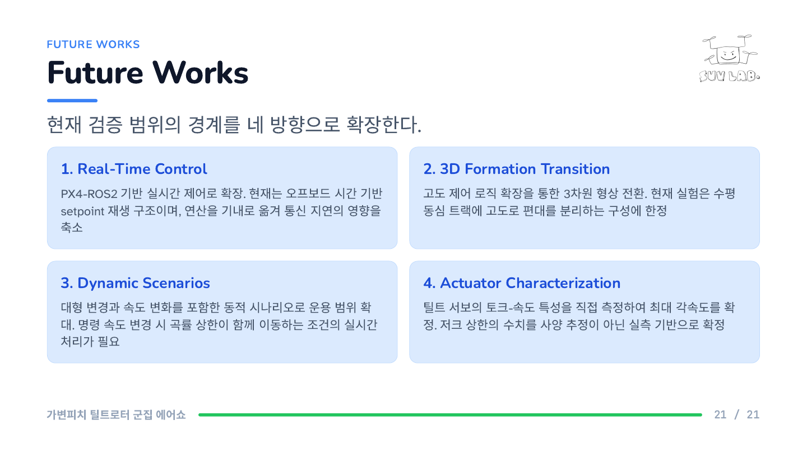
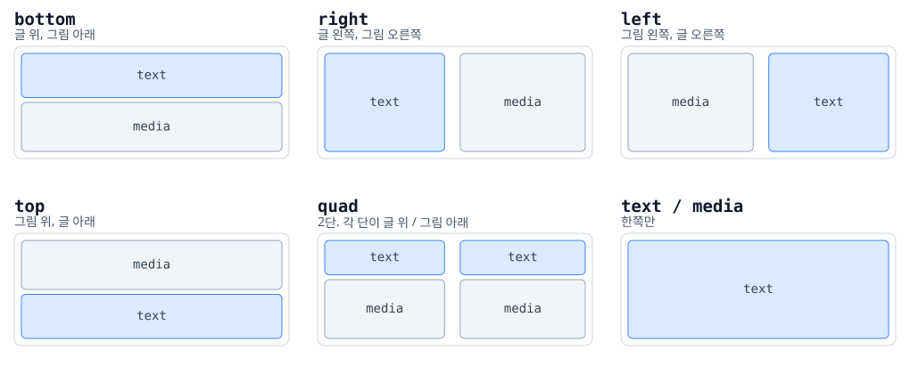
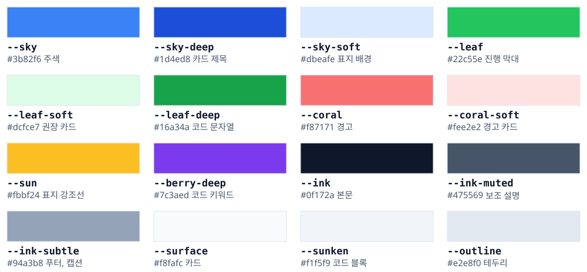

# Slide Deck Design

HTML 로 발표자료를 만들고 PDF 로 뽑는 슬라이드 디자인이다.
아트보드는 1920x1080 (16:9) 이고, 슬라이드 하나가 PDF 한 쪽이 된다.

- 난독증 친화 서체와 24px 하한으로 뒤에서도 읽히는 글자 크기를 강제한다
- 배치를 격자로 고정해 그림, 수식, 표의 열과 오가 저절로 맞는다
- 브라우저에서 그대로 전체 화면 발표가 되고, 발표자 창(노트, 다음 장, 시간)과 질문 대비 창이 붙는다
- 수식은 KaTeX 로 그리고, 번호는 오른쪽 끝에 붙는다


---

## 시작하기

### 1. 파일 복사

새 발표자료 폴더에 다음을 복사한다.

```
deck.css        디자인 구현. 색, 글꼴, 슬라이드 종류, 본문 요소
layout.css      본문 배치 규칙. deck.css 다음에 읽힌다
present.js      전체 화면 발표, 발표자 창과 질문 대비 창, 단계 등장, 동영상
template.html   빈 덱 뼈대. 이 파일을 고쳐 쓴다
```

로고도 함께 둔다. 파일 이름은 `deck.css` 가 참조하는 이름 그대로 쓴다.

```
suvlab_logo.png   표지 왼쪽 위 200px, 본문 오른쪽 위 높이 112px  (--lab-logo)
```

표지와 본문이 같은 로고를 쓴다. `assets/lab_logo.png` 를 그 이름으로 바꿔 쓰거나,
`deck.css` 위쪽의 `--lab-logo` 값을 자기 파일 이름으로 고친다.

### 2. 내용 작성

`template.html` 의 `<section class="slide">` 를 늘리고 줄여 쓴다.
덱은 **표지 · 목차 · 파트 구분 · 본문 · 결론** 으로 구성한다.

### 3. PDF 만들기

```bash
google-chrome --headless=new --disable-gpu --no-pdf-header-footer \
  --virtual-time-budget=30000 --print-to-pdf=deck.pdf deck.html
```

`--virtual-time-budget` 은 KaTeX 와 웹폰트가 다 실릴 때까지 기다리는 시간이다.
수식이 빈 칸으로 나오면 이 값을 늘린다.

---

## 발표하기

브라우저(Chrome, Edge)로 HTML 을 연다. 노트북과 프로젝터를 쓸 때는 이 순서로 한다.

1. `N` 키로 **발표자 창**을 연다(팝업이 막히면 주소창 오른쪽에서 허용). 노트북 화면으로 옮긴다.
2. 덱 창을 프로젝터 화면으로 옮기고 `F` 키로 전체 화면 발표를 시작한다.
3. 질문을 받을 때는 발표자 창의 **질문 대비** 버튼이나 `Q` 키로 질문 대비 창을 연다.

발표자 창은 `F` 보다 먼저 연다. 전체 화면 중에 새 창을 열면 브라우저가 전체 화면을 푼다.
발표자 창에는 현재 장, 다음 장, 노트, 경과 시간이 나오고, 그 창에서 누른 키도 덱을 넘긴다.

| 키 | 동작 |
|---|---|
| `F` · Esc | 발표 시작 · 끝. 보고 있던 슬라이드부터 |
| 스페이스 · `→` · `↓` · PageDown, 클릭 | 다음 단계 또는 다음 장 |
| `←` · `↑` · PageUp | 이전 |
| Home · End | 처음 · 마지막 |
| `B` | 화면 잠깐 끄기 |
| `N` · `Q` | 발표자 창 · 질문 대비 창 |
| (발표자 창) `[` `]` · `C` | 다른 장 노트 미리 보기 · 발표 화면으로 돌아오기 |
| (두 창) `−` `+` | 글자 크기 |
| (발표자 창) 시간 누르기 | 경과 시간 0 으로 |

슬라이드를 눌러도 넘어간다. 링크, 버튼, 동영상 재생 막대는 예외다.
써 보려면 `presenter-example.html` 을 연다.

### 노트

슬라이드 맨 끝에 `aside.notes` 를 둔다. 화면과 인쇄에는 찍히지 않고 발표자 창에만 뜬다.

```html
<section class="slide"> ... <footer class="foot">...</footer>
  <aside class="notes"><p>발표에서 말할 내용</p></aside>
</section>
```

### 단계 등장

요소에 `data-build="1"`, `"2"` … 를 붙이면 넘길 때 그 순서로 나타난다. 발표자 창 번호 옆에 단계(· 1/3)가 뜬다.
`data-only` 를 같이 붙이면 그 단계에서만 보인다. 발표 모드가 아닐 때와 인쇄에서는 모든 단계가 보이고,
`data-static` 을 붙인 요소가 `data-only` 요소 대신 보인다.

### 질문 대비

덱 끝(`</deck-stage>` 앞)에 `<aside class="qa" hidden>` 을 둔다. 안에 `div.qa-group`(h3 + `div.qa-item` 들)을 넣는다.

- `qa-item` 안의 `p.q` 질문, `p.a` 답, `p.m` 메모. `<strong>` 은 노란 강조
- `data-n="02"` 처럼 장 번호(`.folio`)를 적은 묶음은 **지금 장 메모** 버튼이 찾아간다
- `class="qa-group stuck"` 묶음은 **영어가 막힐 때** 버튼을 누르면 크게 덮어 보인다
- 찾기 칸으로 거를 수 있고, 이 창에서 누르는 키는 덱을 넘기지 않는다

자세한 동작은 `present.js` 맨 위 주석에 있다.

---

## 슬라이드 종류

### 표지

번호, 푸터, 부제 문장을 두지 않는다. 주제는 짧은 명사구 하나로 쓴다.

```html
<section class="slide cover" data-label="Cover">
  <span class="course">Lab Seminar</span>
  <span class="kicker">Part Name In English</span>
  <h1 class="display">Deck Title</h1>
  <div class="sun-rule"></div>
  <p class="presenter">소속 발표자</p>
</section>
```

### 목차

`data-label="목차"` 를 그대로 둔다. 이 값에 글자와 줄 간격을 키우는 규칙이 걸려 있다.


### 파트 구분

장이 바뀌는 자리에 놓는다. **장 이름 하나만** 두고 머리말, 푸터, 번호, 로고를 두지 않는다.
배경은 표지와 같은 `--sky-soft` 라 덱 전체의 배경색이 흰색과 sky-soft 둘로 유지된다.

```html
<section class="slide part" data-label="파트 구분">
  <h2 class="part-name">Section Name In English</h2>
</section>
```

### 본문

`.kicker` 는 그 슬라이드가 속한 묶음 이름이며 **영어**로 쓰고 CSS 가 대문자로 바꾼다.
`.title` 은 슬라이드 제목이다. 진행 막대 폭은 현재 번호 나누기 전체 번호다.


### 결론

마지막은 Conclusion 과 Future Works 로 정리한다.




### 번호 매기기

- 표지, 목차, 파트 구분 슬라이드에는 번호를 매기지 않는다
- 실제 내용이 있는 첫 슬라이드가 `01`
- 분모는 번호가 붙는 슬라이드만 센다

---

## 배치

본문은 **글 영역**과 **그림 영역** 둘로 나눈다. 표와 수식은 그림 영역에 들어간다.



```html
<div class="body" data-layout="right" style="--cols: 2; --split: 44%;">
  <div class="body-text">   ... 불릿, 카드 ... </div>
  <div class="body-media">  ... figure, table, 수식 ... </div>
</div>
```

| 변수 | 뜻 |
|---|---|
| `--split` | 두 영역의 비율. 첫 트랙 크기 |
| `--cols` | 그림 격자의 열 수 |
| `--ctpl` / `--rtpl` | 그림 격자의 열·행 트랙 크기 |
| `--fgap` | 그림 사이 간격 |
| `--trow` | 표의 행 높이 |

- 글과 그림이 좌우로 놓이면 **두 영역의 윗변이 같은 높이**에서 시작한다
- 그림이 여러 장이면 균일 격자로 놓아 오와 열을 맞춘다
- 한쪽을 끝까지 줄여도 내용이 반대편으로 넘치지 않는다

---

## 색

배경색은 흰색과 `--sky-soft` 두 가지만 쓴다. 그라디언트는 쓰지 않는다.



---

## 글자 크기

| 토큰 | 값 | 용도 |
|---|---|---|
| `--type-display` | 124px | 표지 제목 |
| `--type-title` | 76px | 슬라이드 제목 |
| `--type-subtitle` | 46px | 리드 문장 |
| `--type-body` | 36px | 본문 기본 |
| `--type-small` | 29px | 불릿, 설명 |
| `--type-code` | 30px | 코드 |
| `--type-kicker` | 26px | 키커, 푸터 |

**24px 아래로 내려가지 않는다.** 그림 안 글자도 마찬가지다.

---

## 수식

KaTeX 로 그린다. 식은 가운데, 번호는 상자 오른쪽 끝, 기호 설명은 그 아래 한 줄이다.

```html
<span class="eq">
  <span class="eq-row">
    <span class="eq-form" data-tex="y = a x^2 + b x + c"></span>
    <span class="eq-no">(1)</span>
  </span>
  <span class="eq-def"><code>a, b, c</code> 계수 · <code>x</code> 입력 · <code>y</code> 출력</span>
</span>
```


- `.eq.tight` 를 붙이면 식 글자가 25px 로 줄어든다. 그 아래로는 내리지 않는다
- `.eq.span` 은 그림 격자에서 한 줄을 다 쓴다
- 한 칸에 수식을 나란히 두면 `--rtpl: auto` 로 행을 내용 높이에 맞춘다. 윗변과 아랫변이 맞는다

### 수식 안에서 하지 않는 것

- 한글, CJK, `·` `×` `→` `≤` `≥` `∈` 같은 비 ASCII 를 넣지 않는다. 설명은 수식 밖에 쓴다
- 가운뎃점 `·`(U+00B7) 은 에러를 낸다. 곱셈은 `\cdot`, 이름 구분은 `,` 나 `-`
- 부등호와 화살표는 명령어로. `\le` `\ge` `\ne` `\to` `\times` `\in`
- `\*` 는 에러다. `T^{*}` 또는 `T^{\star}` 로 쓴다
- `\text{}` 안에는 ASCII 만 넣는다

편집 후 아래로 검사한다.

```python
import re, unicodedata
s = open('deck.html', encoding='utf-8').read()
for tex in re.findall(r'data-tex="([^"]*)"', s):
    bad = [c for c in tex if ord(c) > 127]
    if bad or '\\*' in tex:
        print(tex, [unicodedata.name(c, '?') for c in bad])
```

---

## 그림

`figure.fig` 안에 넣는다. 상자가 그림에 맞추는 것이 아니라 그림이 상자를 채운다.

```html
<figure class="fig"><span class="frame">
  
</span></figure>
```


### 판형을 배치에 맞춘다

같은 그림도 폭이 절반이면 글자가 절반으로 줄어든다.

| 배치 | 그림 폭 | 알맞은 판형 |
|---|---|---|
| 전체 폭 | 약 1696px | 가로로 긴 도해 |
| 좌우 2열 | 약 828px | 세로로 긴 도해 |

`viewBox` 폭이 `W` 인 SVG 는 `그림 상자 폭 / W` 배로 확대된다. 화면에서 24px 이상으로 보이려면

```
SVG 안 글자 크기 >= 24 * W / 그림 상자 폭
```

**글자를 지워서 크기 문제를 해결하지 않는다. 상자 폭을 늘린다.**

### SVG 안 고정폭 글자

`` 로 불러오는 SVG 는 덱이 불러온 웹폰트를 쓰지 못한다.
`font-family="monospace"` 하나만 적으면 시스템 기본 글꼴로 떨어지고,
그 글꼴이 `--` 를 긴 대시로 바꿔 놓는다. 설치된 글꼴 이름을 직접 적는다.

```svg
<text font-family="'DejaVu Sans Mono','Noto Sans Mono',monospace">--sky</text>
```

### 그림을 직접 그릴 때

- 그림 안 글자는 **영어**로 쓴다
- 그림 안에 제목을 넣지 않는다. 제목은 슬라이드가 갖는다
- 글자를 최소한으로 줄인다. 문장이 아니라 이름표다
- 슬라이드 글에 이미 있는 문장을 그림 안에 다시 적지 않는다
- 화살표 방향은 실제 인과와 같게 그린다

---

## 동영상

`figure.fig` 안에서 `img` 자리에 `video` 를 넣는다. 그림과 같은 상자 규칙을 따른다.

```html
<figure class="fig"><span class="frame">
  <video src="imgs/flight.mp4" poster="imgs/flight_poster.jpg"
         controls playsinline></video>
</span></figure>
```

### 기본값은 무음 자동 재생

**속성을 적지 않아도 소리 없이 자동으로 재생한다.** `present.js` 가 로드 시점에 모든
`video` 를 음소거로 고정하고, 발표 모드에서 슬라이드가 바뀌면 이전 동영상을 멈추고
현재 슬라이드의 동영상을 처음부터 재생한다.

| 기본값 | 이유 |
|---|---|
| 무음 | 발표장에서 소리가 터지는 사고를 막는다. 브라우저도 무음일 때만 자동 재생을 허용한다 |
| 자동 재생 | 발표자가 재생 버튼을 찾는 동안 화면이 멈춰 있지 않게 한다 |

**파일 자체도 `-an` 으로 음성 트랙을 빼서 굽는다.** 재생 쪽 음소거만 믿지 않는다.

| 속성 | 뜻 |
|---|---|
| `poster` | **필수.** PDF 에 찍히는 정지 화면. 없으면 검은 칸이 된다 |
| `controls` | 재생 막대. 눌러도 다음 장으로 넘어가지 않는다 |
| `data-noautoplay` | 자동 재생을 끈다. 발표자가 직접 눌러 시작 |
| `data-sound` | 음소거를 푼다. 소리가 내용의 일부일 때만 쓴다 |


poster 만들기. 사진 계열은 JPEG 가 PNG 보다 훨씬 작다.

```bash
ffmpeg -i flight.mp4 -vframes 1 flight_poster.jpg
```

화면 녹화본은 그대로 쓰기에 너무 크다. 1920 폭으로 줄여 다시 굽는다.

```bash
ffmpeg -i master.mp4 -vf scale=1920:-2 -c:v libx264 -preset slow -crf 28 \
  -pix_fmt yuv420p -movflags +faststart -an flight.mp4
```

원본은 저장소에 올리지 말고 따로 보관한다. 덱에는 변환본만 넣는다.

동영상은 **HTML 에 끼워 넣지 않고 별도 파일로 둔다.** `imgs/` 에 두고 경로로 참조한다.
base64 로 넣으면 용량이 33% 늘고 탐색이 느려지며 편집과 버전 관리가 어려워진다.

배포할 때는 HTML, CSS, JS, `imgs/` 를 폴더째 함께 보낸다.

---

## 표

```html
<table class="tbl" data-fixed style="--trow: 20px;">
  <colgroup><col style="width: 40%" /><col style="width: 60%" /></colgroup>
  <thead><tr><th>Header</th><th>Header</th></tr></thead>
  <tbody>
    <tr><td>항목</td><td>내용</td></tr>
  </tbody>
</table>
```

- 머리행은 **영어**로 쓴다
- 열 폭은 `<colgroup>` 에 퍼센트로 적고 `data-fixed` 를 붙인다. 자동 배치는 `<col>` 폭을 무시한다
- 행 높이는 `--trow` 로 정한다. 표 전체가 한 값을 공유해 행이 고르게 유지된다
- 내용이 많아 아래가 잘리면 `--trow` 를 줄이고, 그래도 넘치면 표에 `style="font-size: 25px"` 를 준다

---

## 본문 요소

| 클래스 | 설명 |
|---|---|
| `.lead` | 슬라이드 한 줄 요약 |
| `.cols` / `.cols-wide` / `.cols3` | 2열 / 비대칭 2열 / 3열 |
| `.grid4` / `.grid8` | 2x2 카드, 2열 용어 목록 |
| `.card` | 기본 카드. `.soft` 파랑, `.good` 초록, `.warn` 산호 |
| `.ul` | 불릿 목록. `.leaf` `.coral` 로 점 색 변경 |
| `.chip` | 알약 모양 태그 |
| `.tbl` | 표 |
| `pre.code` / `pre.term` | 코드 / 터미널 블록 |
| `figure.fig` | 그림 |

불릿은 `<strong>말머리</strong> — 설명` 형태로 쓴다. 대시는 전각이 아니라 `—` 다.

**카드는 아껴 쓴다.** 슬라이드 아래쪽에 요약 카드를 습관적으로 붙이지 않는다.

---

## 하지 않는 것

- 이모지
- 그라디언트 배경
- 24px 미만 글자. 그림 안 글자를 포함한다
- 색만으로 의미 전달. 경고는 색과 제목과 문구를 같이 쓴다
- 한 덱에 배경색 3가지 이상
- 표지에 부제 문장
- 표지, 목차, 파트 구분 슬라이드에 번호
- 슬라이드에 출처 캡션
- 습관적인 하단 요약 카드
- 그림 안에 슬라이드 글과 같은 문장

---

## 인쇄에서 그림이 푸터를 덮는 문제

크롬은 인쇄 분할 단계에서 `.body` 에 채움 높이를 주지 않는다. 화면에서 약 600px 인
본문 상자가 인쇄에서는 글 높이로 줄고, 그 결과 그림이 원본 비율대로 커지면서 푸터를 덮는다.

부모에서 높이를 내려주는 방식으로는 해결되지 않는다. 인쇄에서 확실히 아는 값은
페이지 높이뿐이므로, `deck.css` 는 인쇄에서만 `.body` 높이를 `63vh` 로 직접 묶는다.
값을 바꿀 때는 전 쪽의 하단 띠를 훑어 침범이 없는지 확인한다.

---

## 파일

```
deck.css        디자인 구현
layout.css      배치 규칙. 배치 관련 규칙은 여기에만 둔다
present.js      전체 화면 발표, 발표자 창, 질문 대비 창, 단계 등장, 동영상
template.html   빈 덱 뼈대
presenter-example.html  발표자 모드 예시 덱
mydesign.md     디자인 규격 원문. 왜 그렇게 정했는지가 적혀 있다
assets/         로고 예시
imgs/           이 문서의 그림
```

이 폴더가 `deck.css`, `layout.css`, `present.js`, `mydesign.md` 의 유일한 원본이다.
덱 쪽 사본은 빌드가 여기서 내려보낸다. 고칠 때는 이 폴더의 파일을 고친다.

편집기가 만드는 `cde-layout.css` 는 저장할 때마다 다시 쓰이므로 손대지 않는다.
배치 규칙은 `layout.css` 에 둔다. 선택자를 더 구체적으로 쓰면 뒤에 실리는 그 파일보다 이긴다.
